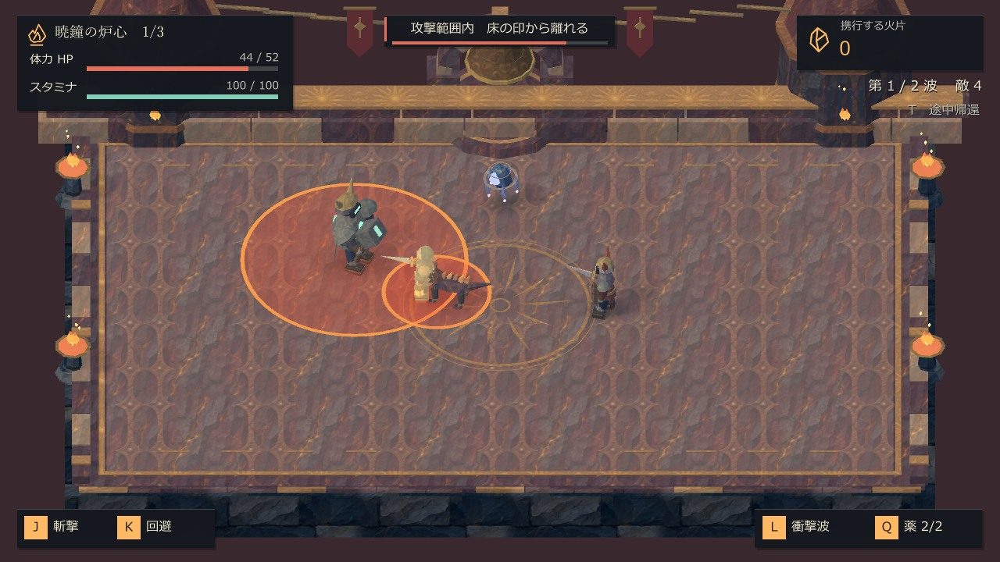

# 灯守の地下回廊

拠点の右手にある門から、火の消えた地下回廊へ向かいます。最初は灰灯の坑道。斬撃で間合いを詰め、敵の攻撃予告から外に出て反撃しましょう。各地区の守り手を越えると次の地区へ進めます。

| 場面 | 操作 |
| --- | --- |
| 拠点 | WASD／矢印で歩き、Eで設備を使う。Jで地区一覧、Kで鍛冶場を直接開けます。 |
| 戦闘 | J／左クリック長押しで斬撃。K／Spaceで回避、Lで灯火の衝撃波、Qで薬びん、Tで帰還を検討。 |
| 選択 | 矢印で選択、Enterで決定、Backspaceで戻る。画面のボタンも使えます。 |

**持ち帰るか、奥へ進むか。** 火片を持って生還すると、灯剣・外套・薬びんを拠点で強化できます。倒れても携行していた火片の半分を確保できます。8種類の遺物はその探索中の斬撃、回避、衝撃波、回復などを変えます。4地区の守り手を倒すと深層の巡回が開き、記録を伸ばせます。

**戦闘後の寄り道。** 第1室と第2室では、敵と増援をすべて退けると室内を自由に歩けます。左の祭壇は回復、右の古櫃は火片5個。どちらか一方に近づいて E を押します。奥の門へ直接進むこともできます。守り手は体力が減ると覚醒するため、奥へ進む前に薬びんと気力を確かめてください。

## 手動で調整する

- [Ember.unity](../Assets/Games/Ember/Ember.unity) がこの作品のシーンです。[Design.asset](../Assets/Games/Ember/Design.asset) でタイトルや音楽を変更できます。
- [EmberJourney.cs](../Assets/Games/Ember/EmberJourney.cs) の `Encounters` は各地区の敵編成、`BaseHealth` と `Speeds` は敵の性能、`Relics` と `RelicNotes` は遺物の一覧です。鍛冶の価格は `Cost` で調整します。
- [EmberHud.cs](../Assets/Games/Ember/EmberHud.cs) に拠点と戦闘UIがあります。[Art](../Assets/Games/Ember/Art) に表紙、地区の挿絵、戦闘曲、効果音を収録しています。表紙は「古代の炉と巨大な青銅の日時計へ下りる灯守」、挿絵は「坑道・根の聖堂・水晶の水路・鐘の炉心」の4場面を画像生成したものです。
