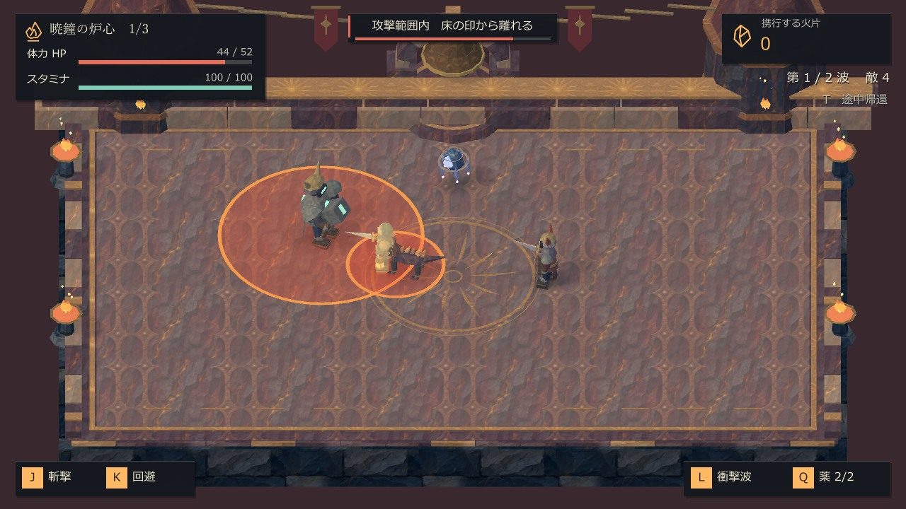

# B拠点ダンジョン探索ゲーム

灯守の地下回廊

拠点の門から地下へ潜り、剣を振り、敵の攻撃を見て身をかわすリアルタイムのアクションRPGです。持ち帰った火片で装備を鍛え、もう一部屋先を目指します。

**[ブラウザーで遊ぶ](https://kaxic.github.io/shiosai-ember-keepers/)** ・ [A〜Fのゲーム一覧](https://kaxic.github.io/shiosai-game-library/#B)

[実際のプレイ映像を見る](https://kaxic.github.io/shiosai-ember-keepers/media/demo.mp4)

## 最初にすること

拠点の右手にある門を調べ、「灰灯の坑道」へ出発しましょう。敵に近づいて斬撃を当て、床に攻撃の予告が出たら回避で範囲の外へ。攻撃が過ぎたところが反撃の機会です。

## 遊びの流れ

部屋を制圧したら、祭壇で傷を癒やすか、古櫃の火片を持ち帰るかを選びます。探索中は遺物で斬撃や回避を強め、帰還後は鍛冶場で灯剣・外套・薬びんを強化できます。

## 目指すもの

全8地区の奥には、それぞれ違う守り手が待っています。潮刃の走る床や結晶波を見切り、16種類の遺物を試しながら攻略を進めましょう。4地区を越えると深層の巡回にも挑めます。

[遊び方と手動で拡張する方法](Guides/Ember.md)

## Unityで開く

Unity Hubでこのフォルダーを追加し、Unity 6000.3.28f1で `Assets/Games/Ember/Ember.unity` を開いて再生します。

Web版は Web Build Support を追加し、Unity の **Shiosai → Build browser game** から再ビルドできます。出力先は `docs` です。

[拡張版の内容](更新内容.md) ・ [Windows版をダウンロード](https://github.com/kaxic/shiosai-ember-keepers/releases/latest)
